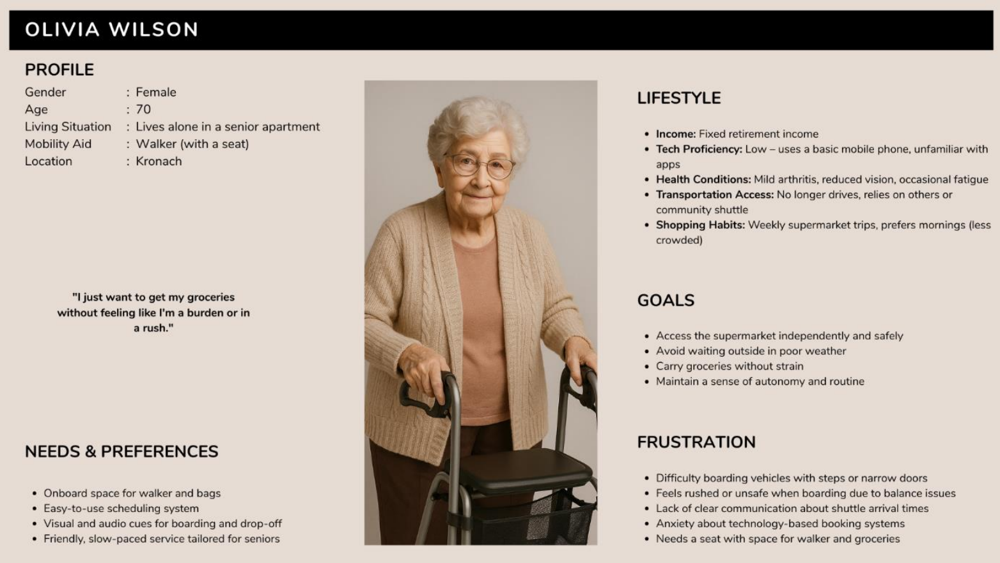
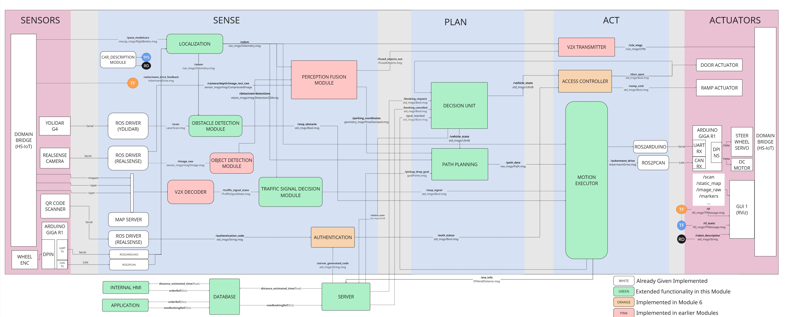
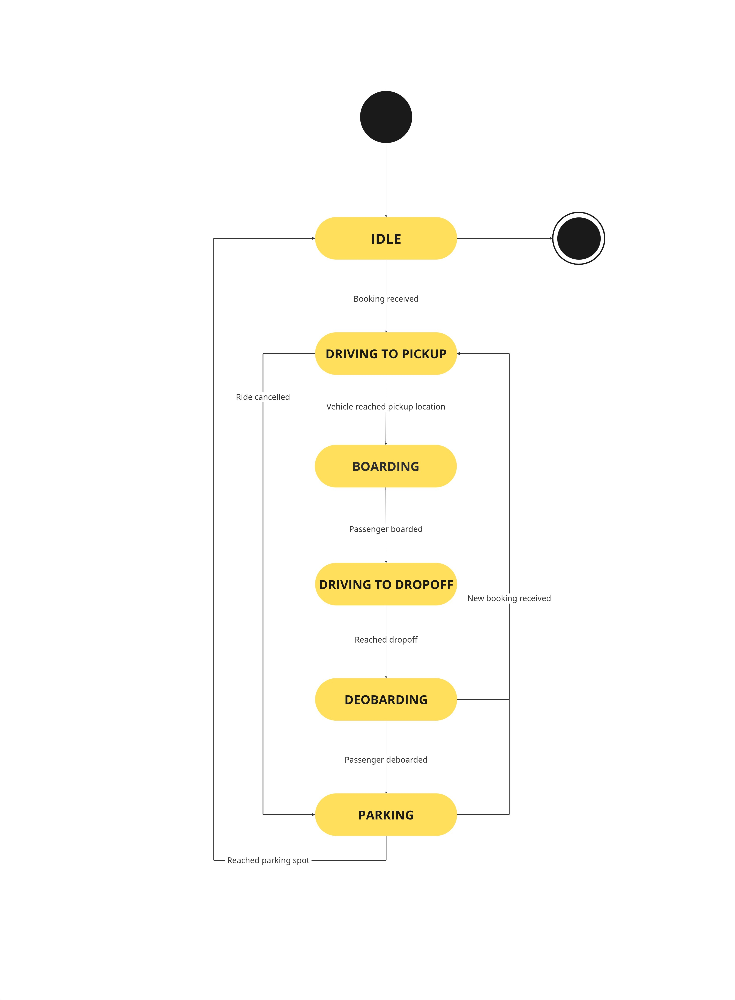
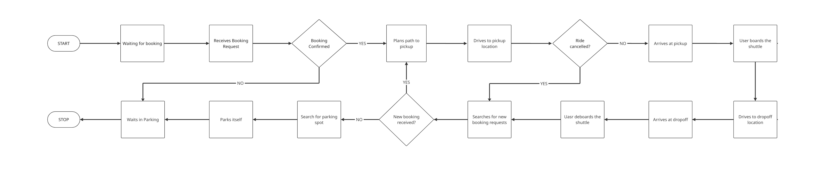
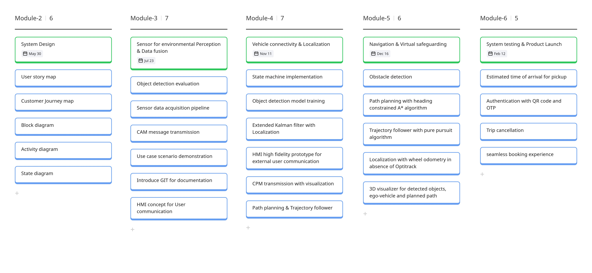
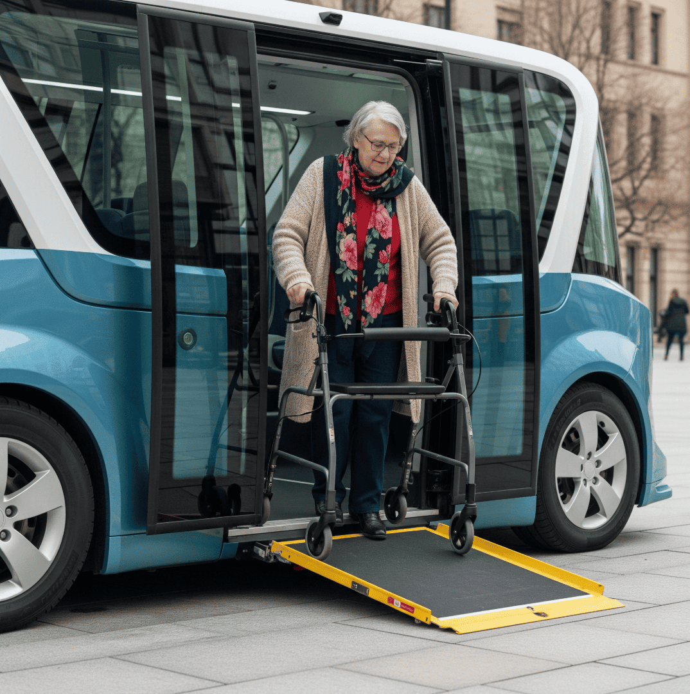
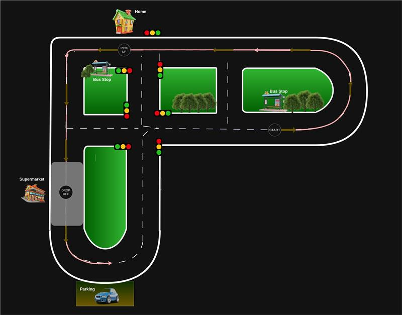

# 📚 Table of Contents

- [Question Zero](#-question-zero)
- [Persona](#-persona)
- [System Architecture](#-system-architecture)
  - [Block Diagram](#-block-diagram)
  - [State Diagram](#-state-diagram)
  - [Activity Diagram](#-activity-diagram)
- [Features](#-features)
- [Project Management](#project-management)
  - [Milestones](#-milestones)
  - [User Stories](#-user-stories)
  - [Effort Estimation and Prioritization](#-effort-estimation-and-prioritization)
  - [Use Case](#-use-case)
  - [Scenario](#-scenario)
- [Team Roles and Responsibilities](#-team-roles-and-responsibilities)

# 🛫 Fly with VoyageX
We are VoyageX, a group of six driven individuals who are using technical prowess, teamwork, and creativity to explore bold paths. Our team, which has strengths in project management, automotive engineering, and information technology, thrives on finding innovative solutions to challenging issues. Curiosity and teamwork drive VoyageX, a place where a range of expertise and common goals come together to launch ideas and propel them beyond their wildest expectations.

---

# 🧠 Question Zero

The concept of **Question Zero** highlights the importance of beginning the design process by focusing on real human needs. It ensures that technology is developed not just for functionality, but to improve lives and help elderly residents in rural areas stay mobile, independent, and socially engaged.

**How can we design an autonomous shuttle service** (What)  
**that ensures transportation for senior citizens with walking aids** (For whom)  
**in Landkreis Kronach (rural areas)** (Where)  
**by providing an on-demand service** (How)  
**to increase their frequency of visits to supermarkets to cater to their everyday needs?** (Why)

---

# 👵 Persona

The **Persona Method** helps designers and engineers deeply understand the **challenges, motivations, and preferences** of their users. By crafting fictional user profiles, we can ensure that our autonomous shuttle solution is tailored to meet real-world demands.

## 💼 Meet Olivia Wilson

As shown in Figure 1, **Olivia Wilson** is a 70-year-old woman living alone in a senior apartment in Kronach. She uses a walker with a seat due to mild arthritis and occasional fatigue. Although she values her independence, her mobility limitations and the lack of accessible public transportation make grocery shopping increasingly difficult.

She no longer drives and feels emotionally burdened when asking family for help. Olivia prefers shopping in the mornings when stores are less crowded but is often deterred by poor weather, long walking distances, and steep bus steps.

  

<strong>Figure 1:</strong> Persona 

---

# 🧩 System Architecture

The system architecture outlines the autonomous shuttle’s functional structure. The block diagram represents a five-layer model which includes Sensors, Sense, Plan, Act and Actuator layer that highlights how data flows from sensors to physical action. The state diagram shows how the shuttle transitions through various modes like idle, driving, and parking. The activity diagram describes all the events that take place during the journey, to show the design of a smooth and accessible service. These elements together provide a clear and structured view of entire system.

## 🧱 Block Diagram

The autonomous shuttle system is designed to provide safe and accessible transportation for all users, especially those with mobility needs. Built on a five-layer architecture (Sensors, Sense, Plan, Act, and Actuator) the system is powered by ROS 2, ensuring compatibility with modern mobility standards. Figure 2 describes the entire block diagram with inputs and outputs all all components of the system.
The Sensors Layer collects essential data to help the shuttle understand its surroundings and external conditions. A Lidar scans the environment to detect obstacles, while an RealSense camera identifies objects. A QR code scanner verifies passengers before boarding, and a Domain Bridge (HS-IoT) ensures continuous connection to external services like traffic updates and signal phasing. Additionally, wheel encoder feedback and Ackermann drive feedback provide vehicle motion information required for state estimation and control. Additionally, wheel encoder feedback and Ackermann drive feedback provide vehicle motion information required for state estimation and control.

In the Sense Layer, this data is processed to create a clear understanding of the shuttle’s surroundings. The Localization Module estimates the shuttle’s position and orientation by interpreting sensor data, while Object Detection and Obstacle Detection Modules recognize people, vehicles, and static hazards. A V2X Decoder gathers messages from nearby connected infrastructure or vehicles, helping the shuttle make informed decisions. Perception Fusion Module calculates the position of the objects from the vehicle. The Authentication Module handles secure passenger identification using scanned QR inputs. A Traffic Signal Decision Module processes traffic signal state information received through V2X communication to support compliant intersection behavior.A Traffic Signal Decision Module processes traffic signal state information received through V2X communication to support compliant intersection behavior.

The Plan Layer determines the shuttle’s behavior based on its understanding of the environment. At its core, the Decision Unit evaluates the conditions and decides whether the shuttle should drive, park, board, or be ideal. The Path Planning Module calculates the most appropriate route, considering current location and direction and goal position. This planning process ensures the shuttle navigates safely and efficiently. The Decision Unit also processes booking requests, goal coordinates, stop signals, and authentication status to coordinate mission-level behavior.The Decision Unit also processes booking requests, goal coordinates, stop signals, and authentication status to coordinate mission-level behavior.

In the Act Layer, the Motion Executor plays a central role, converting the planned path into real-time control actions. This module ensures the shuttle follows the route accurately, handling turns, speed changes, and route corrections. The Access Controller manages physical accessibility features such as the door and ramp, triggered only after verifying safe conditions and authenticated passenger access. Meanwhile, the V2X Transmitter shares the shuttle’s primary details and perception view with surrounding infrastructure and other vehicles for safe interaction. The Motion Executor interfaces with ROS2Arduino and ROS2PCAN to transmit steering and motor commands to the hardware layer.

The Actuator Layer transforms these decisions into physical motion. A Door Actuator and Ramp Actuator provide safe entry and exit, especially for passengers with mobility challenges. The Domain Bridge connects shuttle with external systems. The steering wheel servo and DC motor execute motion commands generated by the control system to enable vehicle movement.

The Server coordinates communication between HMI and the system, processing booking and user interaction data from the application and internal HMI modules. It acts as a central hub for handling service requests, validating user inputs, and relaying necessary information to enable shuttle operations and authentication. 

The Server also manages estimated distance and time calculations and exchanges vehicle state updates between system components and user interfaces.he Server also manages estimated distance and time calculations and exchanges vehicle state updates between system components and user interfaces.

Together, these layers form a robust and intelligent system for autonomous transport. With a focus on safety, and accessibility.

  

<strong>Figure 2:</strong> Block Diagram 

[Visit block diagram Miro Board](https://miro.com/app/board/uXjVJfaT4fM=/?moveToWidget=3458764654877934343&cot=14)

## 🔄 State Diagram
The State Diagram shown in Figure 3 shows the full cycle of the autonomous shuttle. The shuttle starts in the Idle state, where it waits until a booking is received. Once a booking is made, the shuttle transitions to the Driving to Pickup state. In this state, the vehicle navigates from its current position to the user’s pickup location using the planned path while considering safety and road conditions.

When the shuttle reaches the pickup spot, it moves to the Boarding state. After the passenger boards successfully, the shuttle transitions to the Driving to Dropoff state, heading toward the user’s intended destination. Upon reaching the drop-off location, the shuttle switches to the Deboarding state, where the passenger exits safely.

After deboarding, the shuttle moves to the Parking state and navigates to a designated parking spot. Once the parking position is reached, it transitions back to the Idle state and waits for the next booking. If a ride is cancelled while driving to pickup, the shuttle directly transitions to Parking. Similarly, if a new booking is received during Deboarding, the shuttle can transition back to Driving to Pickup.
This well-defined state model ensures efficient, safe, and structured shuttle operation throughout the entire operational workflow.

  

<strong>Figure 3:</strong> State Diagram 

## 🏃 Activity Diagram

The autonomous shuttle service begins when an elderly resident uses a dedicated app to request a ride. The app is designed specifically for seniors, with large icons and a simple interface to make the booking process easy. Once a booking request is received, the system checks if the booking is confirmed. If not, the shuttle does not proceed and waits in the parking area until a valid request comes in. If the booking is successful, the shuttle plans a path to the user’s pickup location.

After planning the route, the shuttle drives to the pickup location. During this phase, the system continuously checks whether the ride has been cancelled. If the ride is cancelled, the shuttle stops the pickup process and proceeds to search for a parking spot. If the ride is not cancelled, the shuttle arrives at the pickup point, and the user boards the shuttle.

Once the user has boarded, the shuttle drives to the drop-off location. After arriving at the destination, the user deboards the shuttle safely. Following drop-off, the shuttle searches for new booking requests. If a new booking is received, the shuttle directly plans a path to the next pickup location. If no new booking is received, the shuttle searches for an available parking spot, parks itself, and waits in the parking area until a new request is received.

Figure 4 illustrates this activity flow, outlining each step of the shuttle’s operation from booking confirmation to pickup, drop-off, and parking, including handling of ride cancellation and new booking scenarios.

  

<strong>Figure 4:</strong> Activity Diagram 

# ✨ Features

## Traffic Light Compliance
 
The shuttle communicates directly with traffic lights and follows their signals automatically. It stops at red lights and proceeds only when the signal allows it, ensuring safe and predictable behavior at intersections without sudden braking or unsafe crossings.
 
The shuttle receives V2X messages describing both the intersection layout and the current traffic signal state. The MAPEM message provides static geographic information such as intersection geometry, lane structure, and signal group indexing, allowing the vehicle to understand how the intersection is organized. The SPATEM message provides dynamic information about the current signal phase and timing, including the active event state and expected phase changes. Using odometry-based position and heading, the system identifies the relevant signal group for the vehicle and evaluates the SPATEM event state to generate a stop or go command. If signal information is unavailable or unclear, the system defaults to a safe stop behavior.
 

 
## Display Live ETA and Distance
 
Passengers can see how long the shuttle will take to arrive and how far the destination is at any moment. The pickup time is visible before boarding in the mobile application, and after boarding the remaining travel time and distance are shown on the onboard screen, updating automatically throughout the journey without requiring any interaction.
 
The system continuously calculates remaining distance based on the vehicle’s current position and its progress along the planned path. Estimated arrival time is computed using the remaining path distance and an average driving speed, and an absolute arrival timestamp is generated using system time. ETA is derived from this absolute arrival time and updated at controlled intervals to prevent frequent fluctuations.

 
## Comfort-Optimized Motion Control
 
The shuttle drives in a smooth and predictable manner by avoiding sudden acceleration, harsh braking, or abrupt steering changes. This ensures a comfortable and stable ride experience, especially for elderly passengers, by making the journey feel safe.
 
The shuttle follows the planned path using a predefined constant driving velocity while continuously adjusting steering based on localization and path planning information. Steering commands are applied smoothly during curve transitions and alignment corrections to prevent abrupt lateral motion. During stopping events, such as traffic lights or detected obstacles, the shuttle reduces speed in a controlled and stable manner to avoid sudden stops. This results in reduced motion disturbances, stable trajectory following, and consistent driving behavior throughout operation.
 

 
## Obstacle-Aware Collision Prevention
 
Passengers experience safe driving as the shuttle automatically detects obstacles and prevents collisions without requiring any action from the user. When an obstacle appears in the shuttle’s path, the vehicle stops in a controlled manner. Once the obstacle is removed or moves out of the collision path, the shuttle resumes driving automatically. This behavior is continuous and transparent to passengers, ensuring a safe ride throughout the journey.
 
The obstacle-aware collision prevention system continuously processes sensor data (LiDAR) to monitor the environment in front of the vehicle. A dynamic region of interest (ROI) is defined based on the shuttle’s direction of travel, distance threshold, and field of view. Detected objects within this ROI are evaluated for collision based on their distance and relative position. If an object is detected within the defined safety distance, a stop command is issued immediately to prevent a collision. The vehicle remains stopped as long as the obstacle is within the collision zone. Once the obstacle moves outside the defined path or safety threshold, the system allows the shuttle to resume motion.
 

 
## Reliable Navigation
 
Passengers experience smooth and continuous shuttle movement even if one positioning sensor temporarily stops working. The shuttle does not stop unexpectedly, jump, or behave abnormally and continues operating safely during the journey.
 
The system maintains vehicle position information when OptiTrack data is temporarily unavailable by detecting missing position updates and switching to a fallback localization method. If the vehicle is stationary, the last known position is retained; if the vehicle is moving, position updates are estimated based on wheel speed. When OptiTrack data becomes available again, the system automatically switches back to normal localization without causing sudden position jumps.
 

 
## Accessible Shuttle Booking and Authentication
 
The shuttle can be booked easily through a simple and easy-to-understand application designed for minimal interaction. The user selects a ride using clear icons, waits for the shuttle to arrive at the pickup location, and authenticates using a QR code or numerical code before entering. The booking can also be cancelled directly from the application before the shuttle reaches the pickup point, giving the user full control over the trip.
 
The shuttle receives booking requests from the application through the backend server, where the request is registered and marked as active. The system transitions the shuttle from idle state to pickup navigation and generates a path to the user’s location. Upon arrival, the shuttle waits for successful user authentication through QR or PIN verification before starting the trip toward the destination. Cancellation requests received before pickup update the booking status on the server, causing the shuttle to stop the current mission safely and either activate the next queued booking or return to the idle state.

# 🗂️ Project Management

This section covers key project management aspects that ensure the autonomous shuttle system is developed efficiently, collaboratively, and aligned with real-world needs. The tools used throughout the project supported version control, task tracking, and documentation. User stories outlined specific goals from the perspective of developers and system components, helping break down complex tasks into manageable units. The use case and scenario described how the shuttle operates in a realistic environment, serving elderly users in rural areas through a simplified booking process and autonomous transportation.
The milestones provided a clear roadmap of deliverables and progress, guiding the team toward successful completion by Module 6. Team roles and responsibilities defined each member's contributions in ongoing collaboration.

## 🛠️ Tools

At **VoyageX**, we prioritize clear communication, collaborative design, and informed decision-making. For team coordination and updates, we use **Microsoft Teams** as our primary communication tools. To visualize ideas, map system behaviors, and co-create diagrams, we rely on **MIRO**, a flexible platform to design the system. Additionally, we use **Git** for version control to manage our codebase and track changes.

For background research and technical understanding, we utilized platforms such as **Google Scholar**, **Wikipedia**, and other freely available academic sources to explore related technologies, accessibility considerations, and autonomous mobility systems. These tools helped us stay  informed, and aligned throughout the development of our solution.

## 📋 User Stories

In this project, user stories are structured to reflect the development process and the technical goals of building a modular vehicle system. These stories capture the responsibilities and intentions of developers, system components, and the team as a whole. This approach helps align the project’s technical milestones with its functional goals.
[Visit User Stories Miro Board](https://miro.com/app/board/uXjVJfaT4fM=/?moveToWidget=3458764649205490567&cot=14)

## 🏗️ Effort Estimation and Prioritization

Effort estimation links detailed development tasks to time and complexity assessments, often by assigning story points or comparable values from team members. By averaging individual ratings and combining them with value judgments, the team determines complexity and prioritizes work. This ensures that high-impact tasks are scheduled first and that project progress is transparent across all contributors.
[Visit our Effort Estimation & Prioritization Sheet](https://docs.google.com/spreadsheets/d/1di1gAz5qqVnctolXtP6w_rUJ2AIbmvh6WOLwQ2dlhRQ/edit?gid=865985763#gid=865985763)

## 📅 Milestones

This image provides a comprehensive overview of the key milestones successfully accomplished throughout the project, highlighting the completed objectives and deliverables achieved up to the end of Module 6, and demonstrating alignment with the overall project timeline.

  

<strong>Figure 5:</strong> Project Milestones

## 🔎 Use Case

Olivia Wilson, a 70-year-old retiree, lives alone in a senior apartment in Kronach. She values her
independence but faces challenges due to mild arthritis and fatigue, relying on a walker with a seat
for mobility. Grocery shopping has become difficult especially in poor weather as the nearest bus
stop is far, and she no longer drives. Though her daughter helps occasionally, Olivia dislikes feeling
dependent and wishes for a simple, stress-free way to shop on her own.

To meet this need, a human-centered Autonomous Shuttle has been launched in
Kronach, designed for seniors with mobility aids. Olivia can easily book a ride through simple,
icon-based mobile application,. The system remembers her preferences, and the shuttle picks her
up directly from her doorstep.
The vehicle features a ramp for easy boarding, a secure spot for her walker, and a quiet, comfortable
cabin with clear audio-visual cues. The ride is direct and smooth, taking her to the supermarket
entrance without delays or complex interactions.

After shopping, she’s picked up at a nearby
zone for her return trip.
This service empowers Olivia to maintain her independence, avoid physical strain, and keep a
regular routine without needing assistance while supporting both her mobility and emotional well-being.

  

<strong>Figure 6:</strong> Use Case

## 🎬 Scenario

The autonomous shuttle operation begins with a ride request initiated by the user, Olivia Wilson, a 70-year-old retiree living independently in a senior apartment in Kronach. Due to mild arthritis and balance issues, she relies on a walker with a seat and avoids long walks or using unreliable rural public transportation. To maintain her independence and manage daily tasks like grocery shopping, she uses a senior-friendly autonomous shuttle service designed for residents with limited mobility.
 
Using a simple, icon-based mobile application, Olivia schedules her trip by selecting key details such as pickup location (her residence), destination (supermarket), and desired departure time. The app is designed with minimal text and large, intuitive icons, making it accessible and stress-free for elderly users.
 
Once the request is submitted, the system assigns a trip to the shuttle and it then generates an optimized route through path planning module. Figure 7 illustrates the complete scenario, showing each step. The autonomous shuttle departs from its parked location and follows the assigned route. Upon arriving at Olivia’s building entrance, it initiates a secure passenger verification process. Olivia confirms her identity by scanning a QR code generated by booking application.
 
Once verified, the vehicle automatically deploys an accessibility ramp and opens its doors. Olivia boards without assistance, aided by the shuttle’s low-floor design, wide doors, secure handrails, and dedicated walker space.
 
The shuttle continues toward the supermarket, using its onboard perception system and V2X communication modules to monitor traffic, receive real-time updates from surrounding infrastructure, and ensure safe navigation. En route, the system detects as construction, obstactle and emergency related detour via a V2X messages or by obstacle detection. The shuttle's path planning module instantly recalculates a new route, and Olivia is informed of the minor adjustment through a clear, friendly voice announcement to ensuring her ride remains predictable and comfortable.
 
At the supermarket, the shuttle stops at the designated accessible entrance, announces the arrival via audio cue, opens the doors, and deploys the ramp. Olivia exits smoothly and begins her shopping while the shuttle starts finding the spot to park itself. And after finding spot it parks itself safely and securely.
 
Once ready to return, Olivia opens the app and taps the “Return Home” icon. The system retrieves her profile and dispatches to the supermarket to pick her up. The return trip mirrors the outbound process: authentication, accessible boarding, safety confirmation, and a direct route back to her residence. Upon arrival, the shuttle deploys the ramp, and Olivia disembarks with her groceries and walker.
 
This seamless, autonomous experience empowers Olivia to manage her errands independently which enhancing her mobility, routine stability, and overall quality of life without needing to depend on others.

  

<strong>Figure 7:</strong> Scenario 

---

# 👥 Team Roles and Responsibilities

Our team is committed to project success through clear communication, timely delivery, and collaborative problem-solving. Each member has specific roles, from managing meetings and documenting progress to overseeing agile practices and ensuring team activities run smoothly. Together, we achieve collective growth and efficiency.

| **Responsibility**                                                                 | **Member**             | 
|------------------------------------------------------------------------------------|------------------------|
| Documentation Lead                        | Ravikumar Savaliya     |
| Visual Collaboration                    | Sonia S.               |
| QA & Compliance Lead                                                 | Monika N.                  |
| Tech & Meeting Coordinator                | Vamsi         |
| Integration Engineer                           | Parth Pahinkar         |
| Team Coordinator                                               | Fenil Savaliya              |

### Component Responsibilities

| Component Name                                                                 | Responsibility         |
|--------------------------------------------------------------------------------|------------------------|
| [Path Planning](https://git.hs-coburg.de/voyagex/vx_path_planning) | Ravikumar               |
| [Obstacle Detection](https://git.hs-coburg.de/voyagex/vx_obstacle_detection)     | Vamsi               |
| [Object Detection](https://git.hs-coburg.de/voyagex/vx_object_detection)         | Vamsi      |
| [Perception Fusion Module](https://git.hs-coburg.de/voyagex/vx_perception_fusion_module)                  | Parth               |
| [Server](https://git.hs-coburg.de/voyagex/vx_server)                             | Sonia               |
| [Motion Executer](https://git.hs-coburg.de/voyagex/vx_motion_executor)   | Fenil         |
| [Desicion Unit](https://git.hs-coburg.de/voyagex/vx_decision_unit)       |Parth                |
| [V2X Transmitter](https://git.hs-coburg.de/voyagex/v2x_transmitter)                           | Parth                |
| [V2X Decoder](https://git.hs-coburg.de/voyagex/vx_v2x_decoder)              | Ravikumar                 |
| [Authentication](https://git.hs-coburg.de/voyagex/vx_authentication)          | Ravikumar & Parth      |
| [Access Controller](https://git.hs-coburg.de/voyagex/vx_access_control)            | Ravikumar & Parth      |
| [Localization](https://git.hs-coburg.de/voyagex/vx_localization) | Monika              |
| [Traffic Signal Decision Module](https://git.hs-coburg.de/voyagex/vx_traffic_signal_decision) | Ravikumar              |
| [Internal HMI](https://git.hs-coburg.de/voyagex/vx_Internal_HMI) |  Sonia               |
| [External HMI](https://git.hs-coburg.de/voyagex/vx_external_HMI)     | Sonia              |
